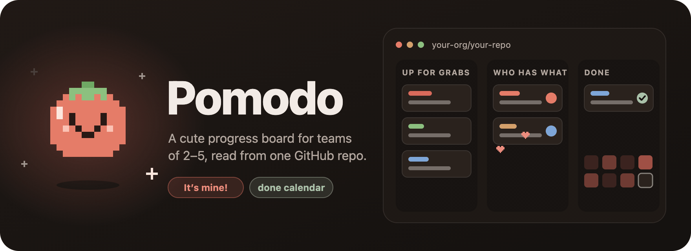
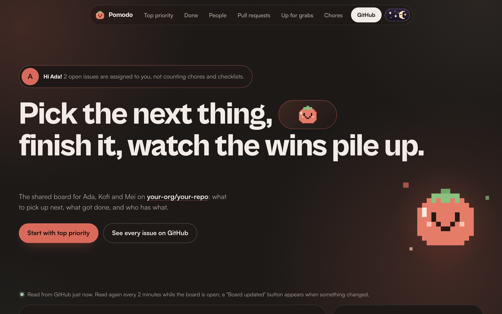
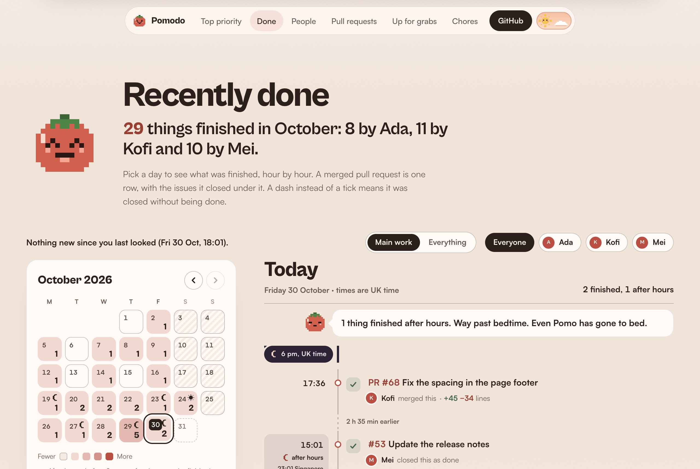
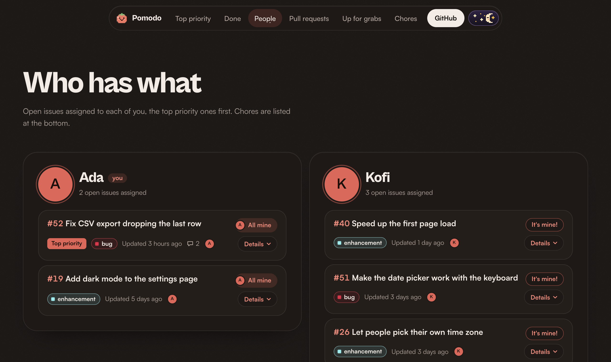
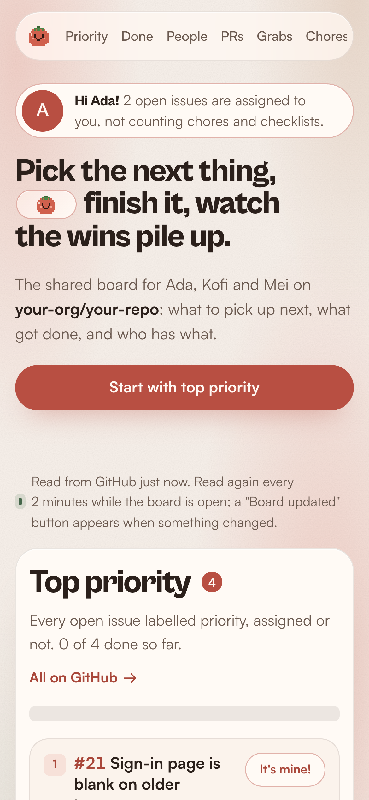
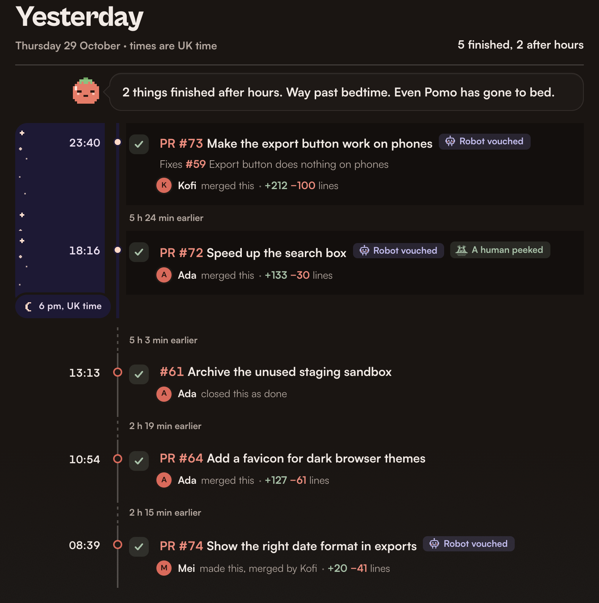
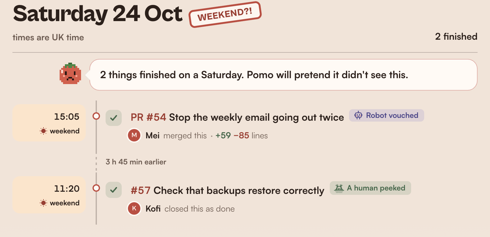
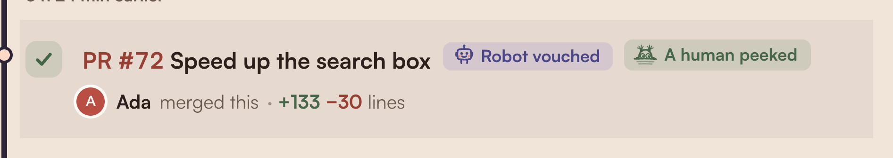

<p align="center">
  <a href="docs/hero.svg"></a>
</p>

<h1 align="center">Pomodo 🍅</h1>
<p align="center"><em>A cute progress board for teams of 2–5, read from one GitHub repo.</em></p>

<p align="center">
  
  
  
  
  
</p>

> **Point Pomodo at your team's GitHub repo and everyone sees, on one page, what comes first, who has what, and what got done this month: no new tool to keep up to date, because the tasks stay in GitHub issues.**

<p align="center">
  
</p>

<table>
  <tr>
    <td width="50%"></td>
    <td width="50%"></td>
  </tr>
  <tr>
    <td><sub><b>Recently done</b>: each day coloured by how much the team finished; pick a day for its timeline. Light mode.</sub></td>
    <td><sub><b>Who has what</b>: one card per person; "It's mine!" assigns you on GitHub. Dark mode.</sub></td>
  </tr>
</table>

<details>
<summary>📱 On a phone</summary>
<p align="center"></p>
</details>

### The cute bits

<table>
  <tr>
    <td width="50%"></td>
    <td width="50%"></td>
  </tr>
  <tr>
    <td><sub><b>Working late?</b> Rows finished after hours (on each person's own clock) sit under a night sky, and Pomo has a word about it. Dark mode.</sub></td>
    <td><sub><b>On a Saturday?!</b> Weekend days get a stamp and a worried Pomo. Light mode.</sub></td>
  </tr>
</table>

<p align="center">
  <br/>
  <sub><b>Robot vouched</b> means an agent saw it work in a browser; <b>A human peeked</b> means a person saw it work in the running app. Both are hand-drawn.</sub>
</p>

<sub>All screenshots use the made-up demo team (`DEMO=1`), so you can see exactly this in one minute; see Quick start below.</sub>

## What it is

Pomodo is a small progress board for a team of 2 to 5 people. It reads the issues and pull requests of one GitHub repo and shows them in one page: what comes first, what got done, who has what, which pull requests are open, which issues nobody has taken, and the small admin jobs. People sign in with their GitHub account, and only the people you list can open it. Tasks stay in GitHub issues; the board never keeps tasks of its own.

What you see, top to bottom:

- **A top card** for work that comes first (the issues with your priority label), progress cards for checklist issues, and a few counts.
- **Recently done**: a month calendar and a day-by-day timeline of what was finished.
- **Who has what**: one card per person.
- **Open pull requests**, **Up for grabs** (open issues nobody has taken) and **Chores** (small admin jobs).

## Quick start: try it with demo data

You need Python 3.12 and [uv](https://docs.astral.sh/uv/). No GitHub account, token or settings are needed.

```bash
uv venv --python 3.12 .venv && uv pip install --python .venv/bin/python -r requirements.txt
DEMO=1 DEV_USER=ada-demo .venv/bin/flask --app main run -p 8765
```

Open http://localhost:8765. You are signed in as `ada-demo`, one of the three made-up people in `pomodo.example.toml`, and the board shows made-up work for them. Nothing is read from or written to GitHub: "It's mine!" and "Checked in the app" change only the copy in memory. The demo data is built when the app starts, so "this month" always has something in it.

If you already have a `pomodo.toml` (next section), the demo uses that team instead, and `DEV_USER` must be one of its logins.

## Set up for your team

### 1. Write your settings

```bash
cp pomodo.example.toml pomodo.toml
```

Edit `pomodo.toml`. **Secrets never go in this file**: it holds only names, labels and time zones, so you can commit it. The token, the OAuth secret and the secret key go in environment variables (below). If `pomodo.toml` is missing, the app logs a warning ("No settings file at ...") and falls back to `pomodo.example.toml`, whose three made-up people could then sign in if their GitHub logins exist. Check that your real file is there before you deploy.

An unknown key or a bad value stops the app at start-up with a message naming the key.

| Key | What it does |
|---|---|
| `title` | The board's name in the page. Default `Pomodo`. |
| `repo` | **Required.** The one repo to read, as `owner/name`. |
| `[time] zone` | The board's own clock, as a time zone name such as `Europe/London`. It decides what counts as Today and Yesterday and which month a day belongs to on the calendar. Default `UTC`. |
| `[time] zone_label` | How the page names that clock, for example `UK` in "UK time". Default: the zone name. |
| `[time] work_start`, `work_end` | Working hours, whole hours from 0 to 24 (defaults 9 and 18). Work finished before `work_start` or from `work_end` on, Monday to Friday, counts as after hours. Weekends count as weekend work, never after hours. |
| `[labels] chore` | Issues with this label go in the Chores card. Default `todo`. |
| `[labels] tracker` | Issues with this label are checklists of other issues. Default `tracker`. |
| `[labels] verified` | The "A human peeked" label: a person saw it work in the running app. Default `human-verified`. |
| `[labels] robot` | The "Robot vouched" label: an agent saw it work in a browser. Default `robot-vouched`. |
| `[labels] priority` | Work that comes first. Default `priority`. |
| `[labels] priority_title` | What the page calls that group. Default `Top priority`. |
| `[labels] nice` | The "Nice to have" label. Default `nice-to-have`. |
| `[labels] milestone` | Optional. A label whose closed/total count shows as a stat at the top. Leave `""` for none. |
| `[done] hide_labels` | Recently done shows main work by default; "Everything" adds work with these labels, as well as chores and trackers. Default `["documentation"]`. |
| `[done] hide_titles` | Also left out of main work: titles starting with any of these, ignoring case, such as `["Docs:"]`. Default none. |
| `[[team]]` | One table per person, in the order of their cards. At least one; 2 to 5 works best. |
| `[[team]] login` | **Required.** Their GitHub login. Logins ignore upper and lower case, and each may appear once. |
| `[[team]] name` | The name shown on the board. Default: the login. |
| `[[team]] zone` | Their own clock, used to decide whether work they finished was after hours. Default: the board's zone. |
| `[[team]] id` | Recommended. Their GitHub account number, from `https://api.github.com/users/<login>` (the `"id"` field). With it, only that exact account can sign in as them: if they ever rename or delete their account, whoever registers the old login next is refused. Without it, the login alone decides. |

The app reads `pomodo.toml` next to the code. Set `POMODO_CONFIG` to use a file somewhere else.

### 2. Make a GitHub token

The board reads and changes issues with one **fine-grained personal access token**. Make it as the person or bot account whose name you are happy to see on GitHub as the author of every change the board makes (see "Taking an issue" below).

On GitHub: Settings, Developer settings, Personal access tokens, Fine-grained tokens, Generate new token.

- **Resource owner**: the user or organisation that owns the repo. (An organisation can require an owner to approve the token first.)
- **Repository access**: Only select repositories, and pick the one repo.
- **Repository permissions**, and nothing else:
  - **Issues: Read and write.** Read to list issues and comments. Write for "It's mine!" (sets the assignee) and "Checked in the app" (adds or removes the label, posts a comment).
  - **Pull requests: Read and write.** Read to list pull requests and reviews. Write because labelling or commenting on a pull request needs it: with Issues write alone, "Checked in the app" on a pull request gets HTTP 403 (the board's error message says which permission is missing).
  - GitHub adds **Metadata: Read** by itself; that is fine.
- Pick an expiry. The token stops working on that date; make a new one and replace the environment variable.

Do not give it Contents access. Without it, a leaked token can edit, label, close and comment on this repo's issues and pull requests, but cannot change code or merge.

### 3. Make a GitHub OAuth app

This is how GitHub tells the board who is signing in. Settings, Developer settings, OAuth Apps, New OAuth App (or the same page under your organisation).

- **Homepage URL**: the address people will open, for example `https://board.example.com`. This is your `PUBLIC_URL`.
- **Authorization callback URL**: `PUBLIC_URL` followed by `/auth/callback`, for example `https://board.example.com/auth/callback`. It must match exactly.
- No scopes to pick: the board asks for none and reads only the person's public login. It uses their token once and throws it away.
- After you create it, copy the **Client ID**, and use "Generate a new client secret" for the **Client secret**.

An OAuth app has one callback URL. If you also want to run against your real repo on your own computer, make a second OAuth app for `http://localhost:8765/auth/callback` (see "Run locally against your real repo").

### 4. Environment variables

| Name | Required? | What it does |
|---|---|---|
| `GITHUB_TOKEN` | Yes, except with `DEMO` or `DEV_FIXTURE` | The fine-grained token from step 2. Used to read the repo and to make changes. |
| `GITHUB_CLIENT_ID` | Yes, to sign in | The OAuth app's Client ID. Without it (or the secret) the sign-in page says sign-in is not set up. |
| `GITHUB_CLIENT_SECRET` | Yes, to sign in | The OAuth app's Client secret. |
| `SECRET_KEY` | Yes, except with `DEMO` or `DEV_FIXTURE` | A random string of at least 32 characters that signs the session cookie; the board refuses to start with a shorter one. Make one with `python -c "import secrets; print(secrets.token_hex(32))"` and keep it the same across restarts. |
| `PUBLIC_URL` | Yes when deployed | The address people open, with `https://` and no trailing slash. It builds the callback address and decides whether the cookie is HTTPS-only (it is, unless this starts with `http://`). |
| `POMODO_PRODUCTION` | Yes on any host except Cloud Run | Set to `1`. It switches off the `DEV_USER` bypass, so nobody can sign in without GitHub. Cloud Run sets `K_SERVICE` itself, which does the same. |
| `POMODO_CONFIG` | No | Path to the settings file. Default: `pomodo.toml` next to the code. |
| `CACHE_SECONDS` | No | How long a read of GitHub is reused before a refresh starts. Default `120` (2 minutes). |
| `PORT` | No | The port gunicorn listens on in the container. The Dockerfile sets `8080`. The local `flask run` uses `-p` instead. |
| `DEMO` | No | `1` shows made-up data and never calls GitHub. For trying it out. |
| `DEV_FIXTURE` | No | Path to a saved GitHub read to show instead of calling GitHub. |
| `DEV_USER` | No | A login to be signed in as, with no GitHub sign-in. Works only together with `DEMO` or `DEV_FIXTURE`, and never when `K_SERVICE` or `POMODO_PRODUCTION` is set. |

`DEMO` and `DEV_FIXTURE` are the "local copy" modes: nothing is ever written to GitHub in them, and a random `SECRET_KEY` is made on each start if you set none.

## Who can open it

Only the logins in `[[team]]`. Anyone else who signs in with GitHub sees a "not on this team" page and can read nothing. The check runs on every request.

- **Add or remove a person**: edit `pomodo.toml` and redeploy (the list is read when the app starts). After a redeploy, someone you removed still has a valid cookie until it runs out, but every page and `/api/*` call now answers "not on this team".
- **Sessions** last 30 days from signing in, then the person signs in again. Signing out clears the cookie in that browser only; a copy of the cookie stays valid until its 30 days are up. Changing `SECRET_KEY` signs everyone out at once.

## Run locally against your real repo

For work on Pomodo itself, or to try your real repo before deploying. Writes go to real GitHub here.

1. Make a second OAuth app whose callback URL is `http://localhost:8765/auth/callback`.
2. Run (use the same name in the browser, `localhost`, not `127.0.0.1`):

```bash
export GITHUB_TOKEN=...            # the fine-grained token
export GITHUB_CLIENT_ID=...        # the localhost OAuth app
export GITHUB_CLIENT_SECRET=...
export SECRET_KEY="$(python3 -c 'import secrets; print(secrets.token_hex(32))')"
export PUBLIC_URL=http://localhost:8765
.venv/bin/flask --app main run -p 8765
```

`PUBLIC_URL` must start with `http://` here. Otherwise the session cookie is marked HTTPS-only, and your browser will not keep it on a plain-http page. `DEV_USER` does nothing in this mode; you sign in through GitHub like everyone else.

**A saved read (`DEV_FIXTURE`).** To work without calling GitHub each time, save one read and show it. The file holds real issue content, so keep it in `dev/`, which git ignores:

```bash
mkdir -p dev && GITHUB_TOKEN=... .venv/bin/python -c 'import json, os, github; from config import CONFIG; json.dump(github.fetch_repo(os.environ["GITHUB_TOKEN"], CONFIG.repo), open("dev/raw.json", "w"))'
DEV_FIXTURE=dev/raw.json DEV_USER=your-login .venv/bin/flask --app main run -p 8765
```

`your-login` must be in `[[team]]`. "It's mine!" then changes only the local copy.

## Deploy

Pomodo runs on any host that runs a container (or a Python web app). The `Dockerfile` starts it with gunicorn on `$PORT` (default 8080).

What the image holds: the app's modules, `templates/`, `static/`, and `pomodo*.toml`, which matches `pomodo.example.toml` and your own `pomodo.toml` if it is there. So **`pomodo.toml` must be in the folder when you build**, and you rebuild when you change it. It holds no secrets. The token, OAuth secret and `SECRET_KEY` are never put in the image; give them to the container as environment variables (on most hosts, as secrets).

Three settings every deployment needs:

1. `PUBLIC_URL` set to the real `https://` address, the same as the OAuth app's homepage.
2. `GITHUB_TOKEN`, `GITHUB_CLIENT_ID`, `GITHUB_CLIENT_SECRET` and a fixed `SECRET_KEY`.
3. `POMODO_PRODUCTION=1`. The Dockerfile already sets it, so a container is treated as deployed (no `DEV_USER`, and no falling back to the example team) unless you deliberately pass `-e POMODO_PRODUCTION=`.

### Any container host

```bash
docker build -t pomodo .
docker run --rm -p 8080:8080 \
  -e GITHUB_TOKEN -e GITHUB_CLIENT_ID -e GITHUB_CLIENT_SECRET -e SECRET_KEY \
  -e PUBLIC_URL=https://board.example.com -e POMODO_PRODUCTION=1 \
  pomodo
```

`-e NAME` with no value passes the variable on from your shell. The board is then on port 8080; put your host's HTTPS in front of it. `/healthz` answers `ok` for health checks, with no sign-in.

### Google Cloud Run, as one example

Replace `<project>` and `<region>`. Sign-in is done by the app, so the service must accept unauthenticated requests (`--allow-unauthenticated`).

```bash
# 1. Keep the three secrets in Secret Manager. (scripts/load-token.sh asks for the token without showing it.)
scripts/load-token.sh pomodo-github-token <project>
printf %s "<the OAuth client secret>" | gcloud secrets create pomodo-oauth-secret --project <project> --data-file=-
python3 -c 'import secrets; print(secrets.token_hex(32), end="")' | gcloud secrets create pomodo-secret-key --project <project> --data-file=-

# 2. Deploy from this folder. (The service's runtime account needs the Secret Manager Secret Accessor role.)
gcloud run deploy pomodo --source . --project <project> --region <region> --allow-unauthenticated \
  --set-secrets GITHUB_TOKEN=pomodo-github-token:latest,GITHUB_CLIENT_SECRET=pomodo-oauth-secret:latest,SECRET_KEY=pomodo-secret-key:latest \
  --set-env-vars GITHUB_CLIENT_ID=<client id>,PUBLIC_URL=https://<your address> \
  --memory 512Mi --max-instances 1
```

Cloud Run addresses look like `https://pomodo-<project number>.<region>.run.app` (check with `gcloud run services describe pomodo --project <project> --region <region> --format 'value(status.url)'`), so you can make the OAuth app before the first deploy. Use that address as `PUBLIC_URL` and in the OAuth app's two URLs. `.gcloudignore` leaves out tests, docs, the virtual environment and `dev/`, and keeps `pomodo.toml`. To see what would be uploaded: `gcloud meta list-files-for-upload .`

To replace the token when it expires, run the `scripts/load-token.sh` line again, then redeploy (a running instance keeps the version it started with).

### Slow first visit after a start

Once the board has a read of GitHub, a page never waits for GitHub: a read older than `CACHE_SECONDS` is shown at once and refreshed in the background. Only the **first visit after the app starts** waits for the read, which can take several seconds for a big repo. On Cloud Run the app starts that read while it boots, which shortens the wait. On other hosts it begins with the first visit.

### "Board updated"

An open page asks `/api/version` every minute while its tab is visible (and right away when you come back to the tab). The answer is a short fingerprint of each issue's and pull request's status: state, title, assignees, labels, review, closed or merged. Comments and update times are left out. When it differs from the one the page was drawn from, a **Board updated · Show it** button appears under the nav; the page never redraws itself under you. That request also keeps the board's GitHub read going, and it stays open for up to 20 seconds while a read runs, because some hosts (Cloud Run) give the app CPU only while a request is open. So while anyone has the board open, what it shows is at most about `CACHE_SECONDS` plus a minute old.

A change you make on the page ("It's mine!", "Checked in the app") gives the page the new version, so it never offers to show you your own click. If your click and someone else's change land in the same minute, theirs stays hidden until the next change. Showing the update reloads the page: the browser keeps your scroll position, but a person chip or a picked calendar day goes back to the default.

Each running copy of the app keeps its own read, so two copies could answer differently and the button could flicker. Run one copy (`--max-instances 1` on Cloud Run); its 8 threads serve a small team easily.

On Cloud Run, a refresh only gets CPU while a request is being served, so it may finish during the next few visits. Two options remove the wait, and both cost money: `--min-instances 1` keeps one copy running, and `--no-cpu-throttling` lets the refresh run between visits.

## Taking an issue

Each open issue has an "It's mine!" button. Pressing it adds you as the issue's assignee on GitHub. The button then shows your photo and "All mine", and a "Claimed!" stamp lands on the row with a burst of hearts. Pressing it again removes you. Pull requests and closed issues have no button. An issue filed already assigned to someone appears in their card, not in "Up for grabs".

- **GitHub shows every change as made by the token's owner.** The board writes with the one server token, not with each person's own login. GitHub records the token's owner as the one who assigned the issue, and the person assigned gets a notification. For "Checked in the app", the comment the board posts names the person.
- **The endpoint** is `POST /api/issues/<number>/assignee` with JSON `{"assigned": true}` or `false`. It accepts JSON only and refuses a request the browser marks as coming from another site (`Sec-Fetch-Site`). It needs a signed-in team member, like every page.

## Marking a fix as checked in the app

When a person has checked a fix in the running app and seen the difference on screen, the issue gets a green "A human peeked" badge in Recently done, with a girl in pigtails peeking over a wall. Only fixes with a visible difference need it, so most closed issues never get one, and the board shows no count of the ones without it.

The one source of truth is the `verified` label (default `human-verified`) on the GitHub issue. A merged pull request that closes no issue can carry it too; on a pull request that closes issues, tick the issues instead.

- **On the board**, each finished issue in Recently done (and each merged pull request row with no issue lines under it) offers "Checked in the app?". With a mouse it shows only on the line you point at. It opens a box for optional notes (where you checked and what you saw, up to 1,000 characters; an @name notifies that person). "Mark as checked" adds the label and posts a comment giving your name, the date and the notes. Pressing a badge unticks it, after a confirm: the label comes off and the board posts a comment "Unticked by NAME on <title>". Earlier comments stay.
- **On GitHub**, add the label by hand and comment with who checked, where, when and what they saw. The badge appears after the board's next read of GitHub (within about `CACHE_SECONDS` while the board is open), and a "Board updated" button then offers to show it.
- **The endpoint** is `POST /api/issues/<number>/checked` with JSON `{"checked": true, "notes": "..."}` or `{"checked": false}`, with the same checks as the assignee endpoint. Asking for the state an issue already has writes nothing. Two people ticking the same issue at the same moment, through two running copies of the app, could still post two comments.

## Robot vouched

An agent that checked a change in a real browser (Playwright, an in-app browser or similar) and saw it work adds the `robot` label (default `robot-vouched`) to the pull request, with a comment saying what it checked, where (local, or which version) and when. The board shows it as a periwinkle "Robot vouched" badge with a little hand-drawn robot, wherever the item appears: in Recently done next to "A human peeked", and in place of the label chip on open issues and pull requests. It is not a person's check and never replaces the `verified` label. There is no button for it on the board.

## How "Recently done" works

A merged pull request is one row, with the issues it closed under it: the ones it lists as closing, and the ones it names (#N) that were closed by the person who merged it within two minutes of the merge. The board never reads which commit closed an issue.

It is a month calendar and a day timeline. The calendar shows this month and last month (in the board's time zone), each day coloured by how many things were finished that day; the arrows switch month. A month where nothing could have been finished yet is left out, so a new board shows one month. Days before the oldest closed item are greyed out and days still to come are dashed; neither can be picked. Today is open when the page loads. The timeline lists the picked day's rows newest first, and a headline above says how many things the month finished and who finished them. The counts on the calendar, the day and the headline all count finished rows, not issues closed without being done. The stat at the top of the page (the last 14 days) is separate. Rows newer than your last visit are marked New (your browser remembers the time of the last read you saw). The person chips filter the calendar, the timeline and the New line together.

It shows **main work** by default. "Everything" (`?done=all`) adds docs, chores and trackers: work with the chore or tracker label, a label in `[done] hide_labels`, or a title starting with one of `[done] hide_titles`. A merged pull request decides for the issues under it, and a day with only left-out work says so instead of "nothing finished". The 14-day count at the top counts everything. The switch never reloads the page (a reload paints the top first and then jumps back): it fetches the other version of Recently done and swaps it in, keeping the person, the day and the New marks, and writes the address so a reload keeps the choice. The links still work without JavaScript.

**After hours** means before `work_start` or from `work_end` on a weekday, on the clock of whoever finished the row (their `zone` in `[[team]]`). A row finished on a Saturday or Sunday is weekend work, never after hours. Pomo, the board's pixel tomato (named after the tomato-shaped kitchen timer of the Pomodoro technique), opens the day with a short line: about work done after hours, early or at the weekend, an evening with nothing finished, or a day with nothing at all.

The other lists are ordered by last update, with top-priority issues first in each person's card; the top card and Chores are ordered by number. "Up for grabs" has a switch between "Recently updated" and "Recently opened" (by the date each issue was opened). A click re-sorts the list where it is. The choice is also in the address (`?order=newest`), so a reload keeps it, and the two links work without JavaScript.

## Labels the board understands

Names come from `[labels]` in `pomodo.toml`; these are the defaults. Every other label is just shown as a chip.

| Label | What the board does with it |
|---|---|
| `todo` (`chore`) | An open issue with it goes in the **Chores** card, not in a person's card or Up for grabs. Chores are small admin jobs. |
| `tracker` | An open issue with it is a checklist of other issues. Its task lines (`- [ ] #12`, same repo only) become a **progress card** at the top, showing how many of the listed issues are closed; the issue itself is not shown as a task. |
| `priority` | The issue goes in the **top card** (called `priority_title`, "Top priority" by default), comes first in each person's card, and is the first group in Up for grabs. The top of the page counts how many are closed. |
| `nice-to-have` (`nice`) | The second group in Up for grabs, and listed after priority work in a person's card. Issues with neither label are "Not sorted yet". |
| `human-verified` (`verified`) | The green "A human peeked" badge in Recently done. |
| `robot-vouched` (`robot`) | The periwinkle "Robot vouched" badge, on finished and open work. Never shown as a chip. |
| `milestone` (empty by default) | If you set a label here, the top of the page shows how many of its issues are closed out of the total. Leave empty to hide it. |

Chores and trackers have no priority of their own.

## The playful layer

A wand cursor, fairy dust that follows the mouse and puffs on every click or tap, star bursts on the people photos, the hello and a successful "It's mine!", Pomo climbing the right edge as you scroll (wide screens only), a tab title that calls you back, and dust floating behind the cards. The effects are adapted from open-source sparkle examples in `static/sparkle/` (each file's header names the source and says what changed). They are always on. With reduced motion set in the computer's settings, nothing moves; the wand stays because it is a still image.

The sky switch (in the nav on wide screens, and always in the footer) picks light or dark: a sun by day, a moon and stars by night. Until someone presses it, the board follows the computer's setting. The browser remembers the choice (`static/theme.js` runs before the page is drawn, so a dark choice never flashes light).

## Tests

```bash
uv pip install --python .venv/bin/python pytest
.venv/bin/python -m pytest -q
```

The tests use a made-up team from `tests/pomodo.test.toml` and ignore the sign-in and demo settings in your shell, so your own `pomodo.toml` and environment cannot change the results.
